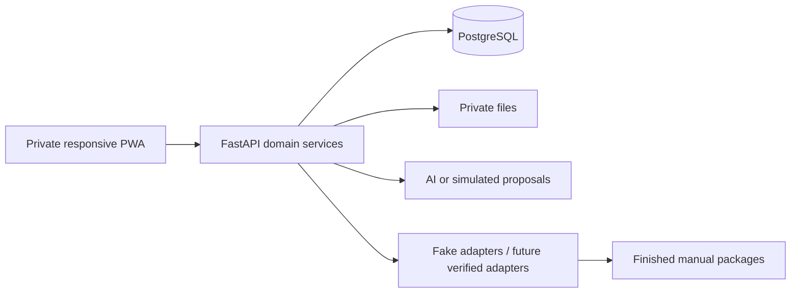

# Event Marketing core architecture proposal

WP0B with WP0C boundary corrections, 2026-10-05; Architect review of corrections required before Phase 1. WP0B clean starting HEAD: `d8c1ac2e416b688c7bc4e619b43bb2de5cb7025b` after Phase 0 baseline `92828ec096ae0c6cb3af6c2129e2533d719b8ece`. WP0C starts from clean architecture HEAD 63fcddc87c91d04b8b8300ef3fadf90a984c2042. This package contains documentation only. Choices below are **ASSUMED engineering proposals** until accepted; explicit product constraints are **CONFIRMED**. Platform permissions, brand approval and recurring defaults remain **UNKNOWN/NEEDS_CLIENT_CONFIRMATION** where noted.

## Product and evidence basis

Preserve source → propose/confirm facts → assemble campaign → review/revise → approve exact version → distribute independent targets/manual packages → record outcomes/history. Models reason; code enforces reality. Event facts and marketing expression stay separate. One organization and primary user; Facebook Groups manual; Facebook Page excluded; private server secrets; no access to the operator's live Drive during development.

No historical Events Master is verified. The approximately 56-event/26-column handoff claim is **UNVERIFIED / POSSIBLY INCORRECT** and never becomes a migration target, mandatory intake form or recurrence/default library. [WP0A](work-package-0a-report.md) contains verified planner/checklist/group/creative evidence and limitations. The source planner's date conflict motivates explicit date/time acceptance; group conflicts motivate raw-row preservation and human review; varied artwork prevents a universal brand template assumption.

## Minimum technology choices

| Area                     | Recommendation / reason                                                                                                                                                                                                                                                                                                 |
| ------------------------ | ----------------------------------------------------------------------------------------------------------------------------------------------------------------------------------------------------------------------------------------------------------------------------------------------------------------------- |
| Backend                  | Supported stable Python, FastAPI, Pydantic 2, Uvicorn. Small domain service functions centralize commands; no framework-heavy agent system. Dependency/patch versions pinned at Phase 1 setup after supported-release check.                                                                                            |
| Database                 | PostgreSQL for local/integration/production from day one. Row locks, transactions, unique constraints and JSONB fit snapshot/concurrency safety. SQLite is not the integration/production substitute; avoid a later concurrency migration.                                                                              |
| Data access / migrations | SQLAlchemy 2 synchronous short transactions with Psycopg; Alembic for reviewed migrations. Explicit locks/CAS for protected commands; ORM version counters are additional guards, never bulk-update authorization.                                                                                                      |
| Frontend                 | React + TypeScript + Vite, React Router, plain CSS modules/design tokens. One responsive client, no Next.js/server rendering requirement, no paid UI middleware. Generate shared types from backend OpenAPI during implementation to avoid divergent contracts.                                                         |
| PWA                      | Install manifest plus small static-shell service worker. No offline private data or background publish. Polish/mobile install QA follows the vertical slice.                                                                                                                                                            |
| AI text                  | Future server-side OpenAI Python SDK/Responses with structured proposals; Pydantic/domain validation remains required. Phase 1 deterministic fake provider by default. No model chosen, key requested or OpenAI call made in WP0B.                                                                                      |
| Images                   | Future server-side OpenAI Image API plus deterministic composition of exact approved logos/text. Phase 1 uses marked synthetic/preprovided safe assets, not polished live generation. Pin bytes/hashes before review.                                                                                                   |
| App authentication       | Allowlisted Google OIDC via Authlib, opaque PostgreSQL-backed secure-cookie session, no public signup. Existing-account suitability ASSUMED; operator sets up identity. No platform OAuth in Phase 1.                                                                                                                   |
| Files                    | Local private directory for development; production private S3-compatible object bucket behind a minimal store/read interface. Metadata/hashes in database, never public bucket/source paths. Original and derivative objects separated.                                                                                |
| Tests                    | pytest + HTTPX for backend; real PostgreSQL test database; Vitest/React Testing Library for selective UI behavior; Playwright for a small vertical end-to-end suite. Fake model/connector clock/failure controls support invariants.                                                                                    |
| Local development        | Python venv, Node supported LTS at setup, Docker Compose for PostgreSQL only; Vite development proxy to backend. One local app origin from browser perspective. Sanitized synthetic fixtures, no live Drive/accounts needed.                                                                                            |
| Repository               | Existing repository; recommend private GitHub remote when the developer separately authorizes creation/push. This package does not create a remote or push. No original-file mutation.                                                                                                                                        |
| Hosting direction        | One managed Linux container service with HTTPS, private managed PostgreSQL and private object storage. Serve built frontend and API from same origin; one Uvicorn process initially. Host/provider/region/cost not needed for Phase 1 local contract and are deliberately deferred. Avoid maintaining a VPS by default. |

PostgreSQL [row locks](https://www.postgresql.org/docs/current/explicit-locking.html), SQLAlchemy [version counters](https://docs.sqlalchemy.org/en/20/orm/versioning.html) and FastAPI's [deployment guidance](https://fastapi.tiangolo.com/deployment/concepts/) support these engineering choices. Vite documents the React/TypeScript starting template in its [guide](https://vite.dev/guide/). These sources validate mechanisms, not business policy.

Official OpenAI [Structured Outputs](https://developers.openai.com/api/docs/guides/structured-outputs) support schema-constrained results; they do not establish factual truth or authorization. Official [image-generation guidance](https://developers.openai.com/api/docs/guides/image-generation) provides the intended generation/edit API route; brand approval and exact asset pinning remain application policy. Models, cost/retention settings and account availability require a later scoped decision; no production provider is activated here.

## Persistence and execution decisions

One Event per occurrence, one-to-many Campaign persistence with one active primary campaign exposed in V1, immutable campaign snapshots from creation. Explicit Approval grants current authority to exactly that snapshot/distribution intent/mode; source Event revision is provenance. Separate approval and start-execution transactions permit safe resume. Material dependency changes withdraw affected authority and require fresh version approval; internal notes do not. Snapshot contains semantic plans and exact assets; adapters may translate mechanics only. Per-target execution plus attempt history and PostgreSQL uniqueness/locking prevent sibling republishing and unsafe concurrent clicks. UNKNOWN results require reconciliation, not blind retry. COMPLETE means no unresolved required action, with explicit manual handoff/acknowledged failure/uncertain-abandonment outcomes distinguished; never universal success. Unresolved UNKNOWN prevents closure. Execution kind and readiness are separate; canonical and selected-target validation run before approval.

Fifteen focused tables in [data model](data-model.md) protect ownership/history. JSON structures avoid people/venue/template/routing over-normalization. No multi-tenant organizations, complex roles, template engine, recurring scheduler, training loop, microservices, event buses, Redis, task queue, paid automation middleware, Zapier/Make/Metricool or Kubernetes.

## Production readiness direction (later phase)

Before live rollout: allowlisted login and CSRF, HTTPS/private network, migration/runtime credentials separated, all secrets server-only, tested source/asset retention and database/object backup restore, bounded logs/error redaction, verified account/destination activation and timeout reconciliation. Deploy approved app image; run migrations once in release operation, not per request/worker. Backup before destructive migration, preserve older snapshot schema readers, rollback app independently of incompatible migrations. No real rollout occurs in WP0C or Phase 1 publishing simulation.

Future LIVE execution is a separate deliberate activation requiring real adapter tests/platform permissions and a new Approval bound to the intended per-destination plan. Connector modes belong to the immutable destination plan, not the CampaignVersion content hash. A configuration change cannot upgrade a historical SIMULATED Approval. WP1I-A exercises a test-only no-network LIVE-shaped path; Phase 1 has no real live publisher. No offline or autonomous scheduler is justified.

## Contract map and review authority

[Domain](domain-model.md), [relational/Event model](data-model.md), [versions/approval](campaign-versioning.md), [state machine](state-machine.md), [adapter contract](connector-contract.md), [platform capability/readiness matrix](platform-capability-matrix.md), [execution safety](execution-safety.md), [source/upload policy](source-material.md), [groups](group-model.md), [authentication](authentication.md), [component boundaries](application-boundaries.md), [test strategy](test-strategy.md) and [Phase 1 plan](phase-1-plan.md) form one proposal. If documents disagree, stop implementation and resolve the contradiction with the Architect; no implementation may silently choose weaker approval/duplicate-safety semantics.

**ARCHITECTURE CONSIDERATION:** Because no verified historical Events Master exists, the canonical Event schema is proposed from verified current Event Marketing workflow evidence, actual supplied planning/checklist artifacts, audited group/creative evidence, confirmed client requirements, verified external requirements where available and explicit product requirements. Narrative 26-field concepts may inform but must not dictate it. Platform-specific schemas and recurring defaults remain deferred until supported.
